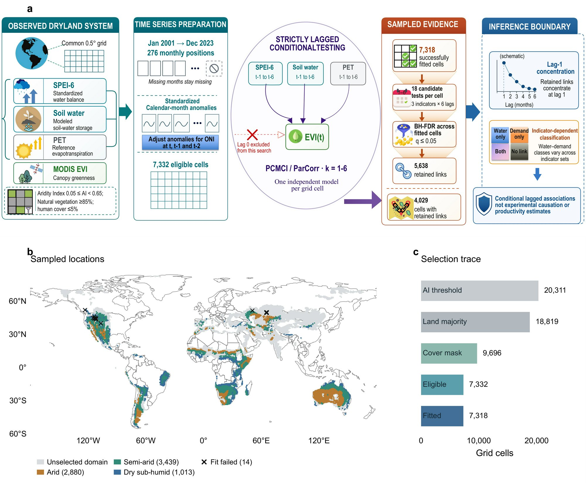
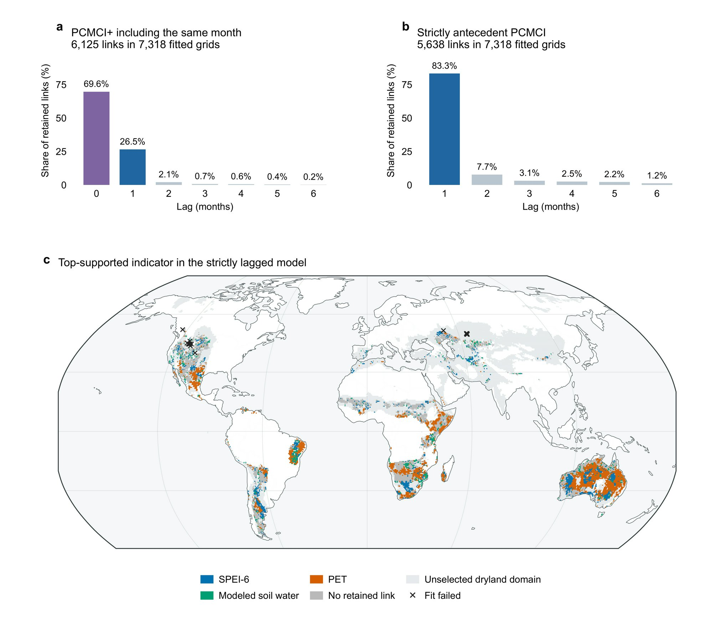
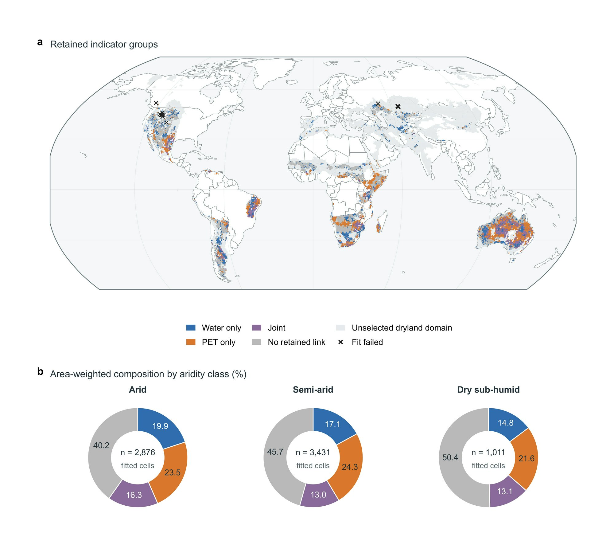
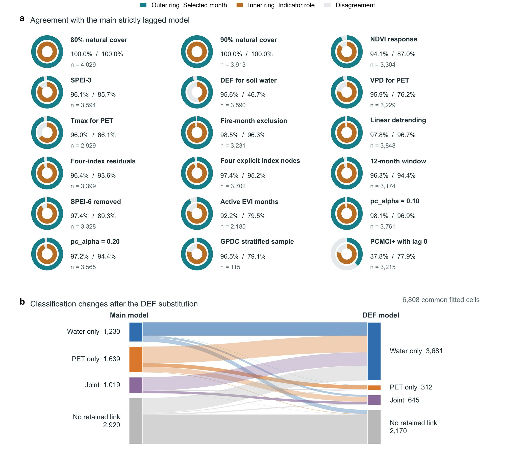

{"slug":"npj-dryland-pcmci","title":"npj Climate and Atmospheric Science 代表作复盘：在全球 7,332 个天然旱地格点上检验水热耦合的时序边界","category":"代表作深读","date":"2026-11","readTime":"8 min read","description":"基于 2001–2023 年（276 个月）MODIS EVI 与多源水文气候数据，通过 PCMCI/PCMCI+ 条件独立性检验与 18 项敏感性实验，证明全球天然旱地植被关联的“月度时序窗口”比“水分或蒸发需求主导分类”更稳健。"}

## 为什么要重新审视“旱地植被受水分还是大气干旱主导”？

全球干旱区（Drylands）覆盖了约 41% 的陆地面积。长期以来，生态水文学界围绕“天然旱地植被绿度波动究竟主要受制于**土壤水分供给（Water Supply）**还是**大气蒸发需求（Atmospheric Evaporative Demand, PET/VPD）**”展开了大量讨论。然而，在月尺度卫星遥感与网格化气候数据集上比较这两类指标时，往往容易忽略一个关键的方法学前提：**贴着同一个月份标签的气候指标，内部承载的历史记忆长度截然不同**。

例如，标记在 $t-1$ 月的六个月标准化降水蒸散指数（`SPEI-6`）实际上汇总了 $t-6$ 至 $t-1$ 共 6 个月的滚动水分平衡；`TerraClimate` 模拟土壤水（`SOIL`）同样携带了前期降水补给与消耗的跨月记忆；而参考蒸散发（`PET`）则综合了当月的温度、辐射、湿度与风速。在这篇发表于 ***npj Climate and Atmospheric Science***（Nature Portfolio, JCR Q1）的代表作中，我们提出了一个更本质的科学问题：

> 当不同气候指标在相同的月尺度光学冠层绿度（MODIS EVI）序列上进行条件滞后拟合时，**不同模型设置究竟是在“哪个月份发生关联（Timing）”上达成更高一致，还是在“水分供给 vs. 大气需求谁占主导（Indicator Role）”上更一致？**

---

## 数据工程与样本筛选：从 20,311 个旱地网格到 7,332 个高纯度天然植被格点

为了避免灌溉农田、城市扩张和低质量遥感像元对天然生态水文信号的污染，我们在全球 $0.5^\circ \times 0.5^\circ$ 网格（$60^\circ\text{S}–85^\circ\text{N}$，2001 年 1 月至 2023 年 12 月共 276 个月）上构建了五级严苛筛选流水线：

1. **干旱指数阈值界定（20,311 个网格中心）**：利用 276 个月的累积降水与参考蒸散发计算干旱指数 $\mathrm{AI}_i = \sum P_{it} / \sum \mathrm{PET}_{it}$，严格限定 $0.05 \le \mathrm{AI} < 0.65$（排除极端干旱荒漠 $\mathrm{AI} < 0.05$，划分为干旱区 $0.05–0.20$、半干旱区 $0.20–0.50$ 和干亚湿润区 $0.50–0.65$）。
2. **陆地主导掩膜（18,819 个格点）**：仅保留陆地面积占多数的网格作为覆盖率分母。
3. **23 年土地覆盖纯度筛选（9,696 个格点）**：对 2001–2023 年全部 23 期 `MCD12C1 v061` IGBP 土地覆盖比例求均值，要求每个格点**自然植被比例 $\ge 85\%$** 且**人为覆盖（农田、城市及镶嵌带）$\le 5\%$**。
4. **遥感观测质量与信噪比控制（7,332 个合格候选格点）**：将原生 $0.05^\circ$ 的 `MOD13C2 v061` EVI 仅使用高可靠性像元（Reliability 0 或 1）聚合至 $0.5^\circ$，剔除裸地极低绿度噪声（要求原始均值 $\overline{\mathrm{EVI}} \ge 0.02$），并在日历月标准化异常 $z_{iym} = (x_{iym} - \bar{x}_{im}) / s_{im}$ 后线性回归扣除厄尔尼诺—南方涛动（`ONI` 在 $t, t-1, t-2$）的全球遥相关同步效应。
5. **逐格点独立因果发现拟合（7,318 个成功拟合）**：占全球陆地主导旱地网格的 **39.0%**（余弦纬度面积加权占比 **42.4%**），其中半干旱区 3,439 个、干旱区 2,880 个、干亚湿润区 1,013 个。

---

## 核心发现一：高度集中的“当月至前一个月”耦合窗口

我们在全部 7,318 个拟合格点上分别运行了两组基于条件独立性的时间序列搜索，并对整个有限 $p$ 值家族实施全局 **Benjamini–Hochberg 假发现率校正（$\mathrm{BH-FDR}\ q \le 0.05$）**：

- **包含当月的 `PCMCI+` 搜索（滞后 $0–6$ 个月）**：共保留 **6,125 条**显著“气候 $\to$ EVI”关联，其中 **69.6%（4,263 条）落在当月（Lag 0）**，**26.5%（1,626 条）落在前一个月（Lag 1）**。两者合计占全部检出关联的 **96.1%**。
- **严格前导的 `PCMCI` 搜索（滞后 $1–6$ 个月，要求气候观测严格早于绿度）**：在 4,029 个检出格点中共保留 **5,638 条**关联，其中 **83.3%（4,694 条）集中于前一个月（Lag 1）**，而 Lag 2 骤降至 7.7%（444 条），Lag 3 仅 3.1%（166 条）。若按格点统计首要支持滞后月，**88.2%（3,552 / 4,029）的格点首推 Lag 1**。

---

## 核心发现二：水热指标的空间交错与 1,019 个“双路径共存”格点

在严格前导模型的 4,029 个检出格点中，若仅按每个格点 BH 校正后 $q$ 值最小的首要关联（Top-supported link）贴标签：
- **参考蒸散发（`PET`）**在 **58.1%（2,341 个格点）**中排名第一（偏相关系数中位数为 $-0.241$，2,850 条保留关联中 2,585 条为负，反映大气高蒸发需求下气孔调节对冠层活动的抑制）；
- **六个月水分平衡（`SPEI-6`）**在 **27.6%（1,113 个格点）**中排名第一（偏相关系数中位数 $+0.222$）；
- **模拟土壤水（`SOIL`）**在 **14.3%（575 个格点）**中排名第一（偏相关系数中位数 $+0.218$）。

但若跳出“单一胜者标签”、考察所有通过 FDR 阈值的保留关联（图 3），我们发现：**1,344 个格点仅保留水分指标（SPEI-6 / SOIL）关联，1,666 个格点仅保留 PET 关联，而有 1,019 个格点同时保留了水分供给与大气需求两类显著条件关联**。这证明水分可利用性与大气蒸发需求在超过四分之一的检出旱地中提供了互补而非互斥的局地绿度信息。

---

## 核心发现三：跨越 18 项敏感性检验——“时序永远比路径更稳”

为了检验结论是否依赖于特定的指标代理或模型超参数，我们设计了 **18 项系统性敏感性与稳健性实验**（涵盖 80%/90% 自然植被阈值、EVI 替换为 `NDVI`、SPEI-6 替换为 `SPEI-3` 或直接剔除、SOIL 替换为气候水分亏缺 `DEF`、PET 替换为饱和水汽压差 `VPD` 或最高温 $T_{\max}$、排除 `MCD64A1` 火灾月份、线性去趋势、4 指数遥相关控制、扩展至 12 个月滞后窗、限定植被活跃生长季、`pc_alpha` 0.10/0.20、2,000 次 $10^\circ/15^\circ/20^\circ$ 空间块重采样，以及基于高斯过程回归距离相关的非线性 `GPDC` 核检验）：

| 敏感性对照实验 | 共同检出格点数 ($n$) | 选中月份一致率 (Selected Month) | 水分/需求角色一致率 (Indicator Role) | 核心方法学启示 |
| :--- | :---: | :---: | :---: | :--- |
| **SOIL 替换为水分亏缺 DEF** | 3,590 | **95.6%** | **46.7%** | 蓄水量换成蒸散缺口后，时序几乎不变，但主导类别大规模翻转 |
| **PET 替换为最高温 $T_{\max}$** | 2,929 | **96.0%** | **66.1%** | 综合蒸发需求换成单一温度代理，时序依然保持 96% 一致 |
| **PET 替换为水汽压差 VPD** | 3,229 | **95.9%** | **76.2%** | 时序稳定性高出指标角色一致性近 20 个百分点 |
| **EVI 替换为同源 NDVI** | 3,304 | **94.1%** | **87.0%** | 更换光学植被指数后，Lag-1 主导规律高度稳健 |
| **直接剔除 SPEI-6（仅留 SOIL+PET）** | 3,328 | **97.4%** | **89.3%** | 剔除 6 个月累积指标后，Lag-1 占比仍达 **84.5%** |
| **排除火灾燃烧月份 (MCD64A1)** | 3,231 | **98.5%** | **96.3%** | 火干扰不改变前导月集中特征 |
| **非线性 GPDC 子样本对照** | 115 | **96.5%** | **79.1%** | 非线性条件独立性检验下月份一致性依然高达 96.5% |

最具代表性的是将土壤蓄水（`SOIL`）替换为气候水分亏缺（`DEF`）：在 6,808 个共同拟合格点中，仅水分主导（Water-only）格点从 1,230 个激增至 3,681 个，导致宽泛的水分/需求角色一致率降至 **46.7%**；然而在两者共同检出的 3,590 个格点中，**选中滞后月份的一致率却高达 95.6%**。

这一对比清晰地划定了月尺度遥感生态分析的**推断边界**：月度条件关联能够极稳健地锁定气候与冠层绿度耦合的**时间窗口（当月至前一个月）**，但将单一统计胜出指标直接等同于独立的植物生理限制机制则具有强烈的代理变量依赖性。

- [查看代表作专题详情页与完整图表库](/research/npj-dryland-hydroclimate/)
- [返回全部学术发表列表](/research/)
