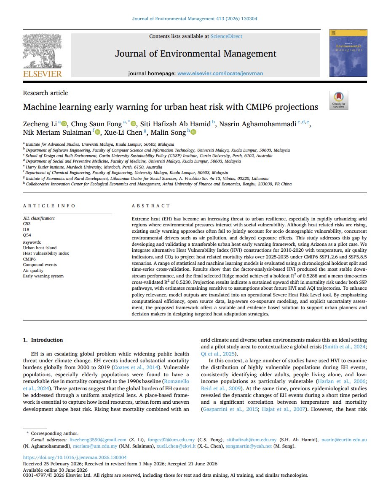

{"slug":"climate-ml","title":"从 CMIP6 气候情景到可检验的城市热风险早期预警：时间顺序留出与机器学习实践","category":"气候预警与 ML","date":"2026-07","readTime":"6 min read","description":"基于 Journal of Environmental Management (2026) 一作论文，探讨如何防止时间序列数据泄露、耦合滞后空气污染暴露，并将 CMIP6 情景外推转化为业务化高温风险分级工具。"}

## 一、先定义预警任务：决不能用“未来信息”训练历史拟合模型

在城市极端高温（Extreme Heat, EH）早期预警系统的设计中，最常见的方法学陷阱是**把历史插值或随机交叉验证（Random K-Fold CV）的高拟合优度误认为真实世界的未来预警能力**。

在发表于 ***Journal of Environmental Management***（2026, Vol. 413, 130304, JCR Q1）的研究中，我们从业务化发布的决策场景出发确立了第一原则：如果预警目标是提前发出城市高温健康风险警报，模型在预测时刻 $t$ 只能调用当时已观测或已发布的环境变量与滞后暴露项。

为此，我们在方法学上严格区分了三个层次：
1. **多源热脆弱性指数（HVI）构建对比**：系统评估了 2010–2020 年多种 HVI 构建策略（包括基于因子分析 Factor-Analysis 的社会人口脆弱性合成与替代加权方案），量化老龄人口、独居群体、低收入社区与城市热岛暴露的空间叠加。
2. **复合暴露与滞后效应（Lag-Aware Co-Exposure）**：高温对公共健康的冲击从不孤立发生。我们将气温指标与同期及滞后的空气质量指标（`AQI`、$\mathrm{CO}_2$ 及协同污染物）共同纳入特征空间，捕捉“高温 + 空气污染”复合事件对死亡风险的放大效应。
3. **无数据泄露的时序验证架构**：完全摒弃随机打乱切分，采用**严格时间顺序留出（Chronological Holdout Split）**与**滚动时间序列交叉验证（Time-Series Cross-Validation, TS-CV）**。



---

## 二、为什么在严苛时序验证下，正则化模型往往优于过度复杂的黑盒？

在亚利桑那州（Arizona）干旱城市群的试点验证中，我们对比了多种统计与机器学习回归器在固定未来时间窗上的外推表现。实验结果给出了一个对工程落地极具价值的结论：

- **基于因子分析（Factor-Analysis）的 HVI 构建方案**在所有下游预测模型中表现最为稳定，有效抑制了多维社会经济高度共线性带来的方差膨胀；
- 最终优选的 **Ridge 正则化回归模型**在严格时间顺序留出集上取得了 **$\mathrm{Holdout}\ R^2 = 0.5288$**，在多折滚动时间序列交叉验证上取得了 **$\mathrm{Mean\ TS-CV}\ R^2 = 0.5230$**——留出集与交叉验证集高度吻合，证明模型学习到的是跨年份稳定的温—污—脆弱性耦合信号，而非对特定历史年份噪声的过拟合。

```python
# 严格遵循时间顺序的滚动交叉验证与留出评估示意
from sklearn.model_selection import TimeSeriesSplit
from sklearn.linear_model import Ridge
from sklearn.metrics import r2_score

tscv = TimeSeriesSplit(n_splits=5)
cv_scores = []

for train_idx, val_idx in tscv.split(X_train_chronological):
    model = Ridge(alpha=1.0)
    model.fit(X_train_chronological[train_idx], y_train_chronological[train_idx])
    preds = model.predict(X_train_chronological[val_idx])
    cv_scores.append(r2_score(y_train_chronological[val_idx], preds))
```

---

## 三、给 CMIP6 未来情景单独留出不确定性边界

把训练好的历史模型直接套用到第六阶段耦合模式比较计划（`CMIP6`）的未来气候投射上，必须回答一个外推边界问题：**2025–2035 年的气候输入分布，是否已经超出了 2010–2020 年历史训练期所覆盖的范围？**

在论文中，我们将模型耦合至 CMIP6 的两条代表性共享社会经济路径：
- **`SSP1-2.6`（可持续发展与低碳减排路径）**
- **`SSP5-8.5`（高化石燃料依赖与强辐射强迫路径）**

投射结果表明，在两条 SSP 路径下，2025–2035 年城市高温相关死亡风险均呈现持续上升趋势；同时，通过敏感性分析我们证实，未来风险绝对水平对“未来社会脆弱性（HVI）与空气质量（AQI）演变轨迹”的假设高度敏感。如果仅改善气候或仅高估技术适应而忽视老龄化与城市局地空气污染治理，高温健康负担仍将突破历史基线。

为了跨越“学术论文指标”与“市政应急行动”之间的鸿沟，我们将连续预测输出转化为业务化的**严重热风险等级工具（Severe Heat Risk Level Tool）**，用开源数据、高计算效率和显式不确定性区间支撑城市规划者与公共卫生部门制定靶向防暑干预策略。

- [阅读期刊原文 · Journal of Environmental Management (DOI: 10.1016/j.jenvman.2026.130304)](https://doi.org/10.1016/j.jenvman.2026.130304)
