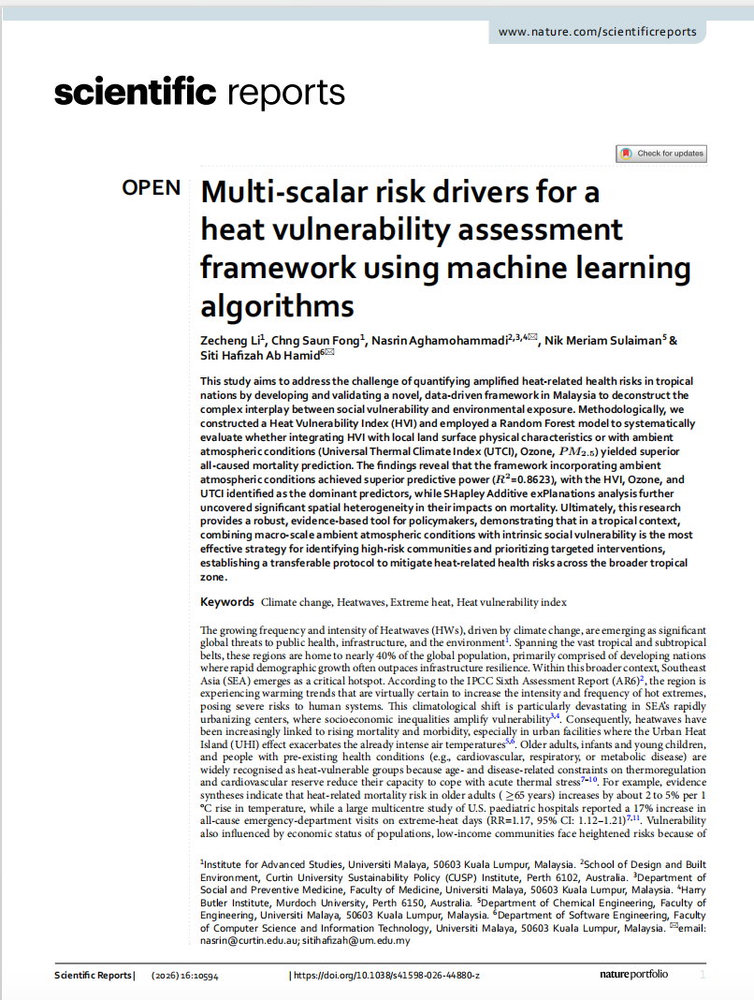

{"slug":"vulnerability-index","title":"热带多尺度热脆弱性评估框架：Random Forest + SHAP 如何连接环境暴露与全因死亡结局","category":"气候与公共健康","date":"2026-05","readTime":"7 min read","description":"基于 Scientific Reports (2026) 一作论文，解析马来西亚 13 州与 3 联邦直辖区十年面板数据中，宏观大气热应力（UTCI、O3、PM2.5）与局地地表特征对死亡风险预测（R² = 0.8623）的贡献差异。"}

## 一、构建热脆弱性指数（HVI）之后，如何用真实健康结局检验它的信息增量？

许多热脆弱性研究停留在“用主成分分析或熵权法画一张脆弱性地图”，却没有回答决策者最关心的问题：**这张指数地图真的能解释或预测人群健康受损（如超额死亡或急诊入院）吗？当它与不同尺度的环境暴露结合时，哪套变量组合能提供最强的预测信息？**

在发表于 ***Scientific Reports***（2026, Vol. 16, 10594, Nature Portfolio, JCR Q1）的研究中，我们将热带快速发展国家**马来西亚（覆盖全部 13 个州与 3 个联邦直辖区，2010–2020 年）**作为研究区域，设计了一套“指数构建 $\to$ 多尺度环境耦合 $\to$ 机器学习验证 $\to$ SHAP 可解释归因”的闭环验证框架。

---

## 二、局地地表物理特征 vs. 宏观大气环境条件：谁与 HVI 耦合更强？

热带城市全年高温高湿，热风险不仅来自地表建筑密度与绿地缺失，还受到大气综合热应力与光化学污染的强烈调制。为了严格检验不同尺度环境因子的贡献，我们在固定相同的社会脆弱性指数（HVI）与全因死亡率（All-Cause Mortality）结局的前提下，设置了两组对照建模实验：

1. **框架 A（HVI + 局地地表物理特征）**：耦合地表覆盖、城市化形态与局地物理环境指标；
2. **框架 B（HVI + 宏观大气环境条件）**：耦合**通用热气候指数（Universal Thermal Climate Index, `UTCI`）**、近地面**臭氧（$\mathrm{O}_3$）**与**细颗粒物（$\mathrm{PM}_{2.5}$）**。

通过随机森林（`Random Forest`）模型的系统评估，结果清晰地表明：
- **融合宏观大气环境条件的框架 B 取得了显著更优的全因死亡率预测性能（$R^2 = 0.8623$）**；
- **`HVI`、`Ozone`（臭氧）与 `UTCI`（通用热气候指数）**被识别为决定马来西亚全因死亡波动的三大主导预测因子。

这一结果具有鲜明的气候带针对性：在常年湿热的赤道与热带地区，单纯依赖静态地表覆盖或单一气温指标不足以刻画真实人体热生理负荷；综合了温、湿、风、辐射的 `UTCI` 与伴随强日照产生的臭氧污染（$\mathrm{O}_3$），与人口内在社会脆弱性（`HVI`）形成了强烈的协同放大效应。

---

## 三、SHAP 空间异质性归因：读地图之前先读懂“分析尺度”

为了让机器学习模型不只是给出一个全局高 $R^2$，我们引入 **SHAP（SHapley Additive exPlanations）** 对马来西亚各州和联邦直辖区的驱动机制进行了多尺度拆解：

- **高度城市化与高密度联邦直辖区（如吉隆坡 Kuala Lumpur、布城 Putrajaya 及雪兰莪州 Selangor）**：大气热应力（`UTCI`）与臭氧/细颗粒物（$\mathrm{O}_3 / \mathrm{PM}_{2.5}$）的边际推升效应尤为突出，反映出城市热岛与交通/工业排放在高密度人口集聚区的叠加风险；
- **医疗基础设施相对薄弱或老龄化/社会经济脆弱度较高的州属**：内在社会脆弱性指数（`HVI`）在 SHAP 归因中占据更高权重，说明即便经历相近的大气热暴露，应对能力（Adaptive Capacity）的短板也会直接转化为更高的死亡风险。

这也引出了我们在论文与政策建议中反复强调的**空间尺度原则**：州级（State-level）面板数据验证的是宏观大气条件与社会脆弱性在行政区尺度上的稳健耦合关系（$R^2 = 0.8623$）；当政策目标进一步下沉到具体社区或街区的降温中心选址时，则必须将这套“宏观大气预警 + 社区高分辨率脆弱性底图”嵌套使用，使验证尺度与干预尺度严格对齐。

- [阅读期刊原文 · Scientific Reports (DOI: 10.1038/s41598-026-44880-z)](https://doi.org/10.1038/s41598-026-44880-z)
